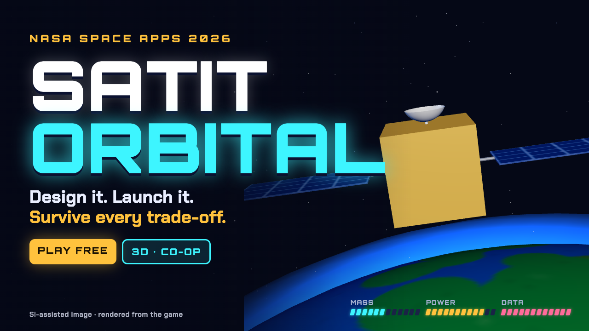
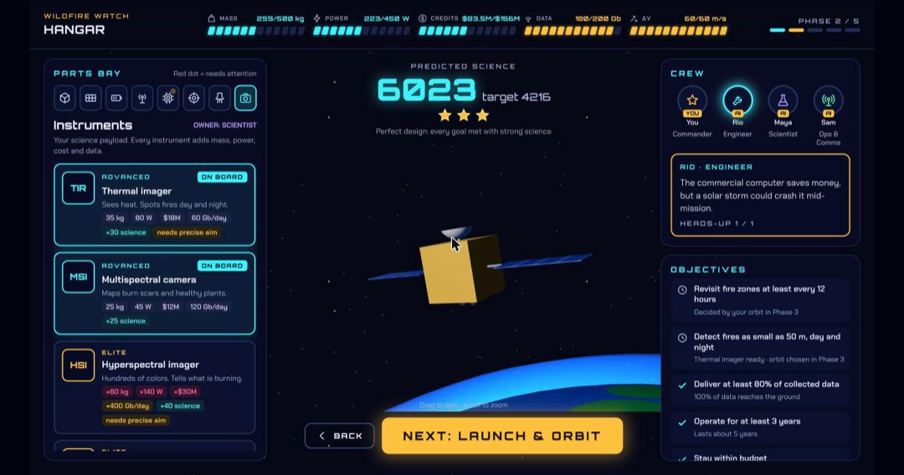
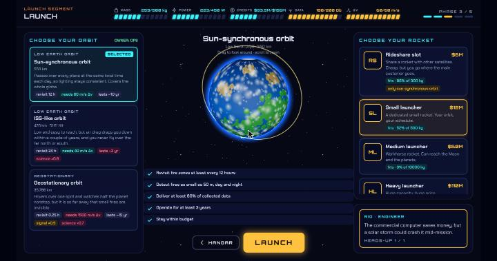
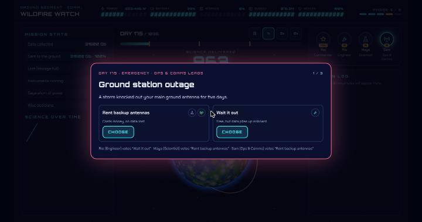
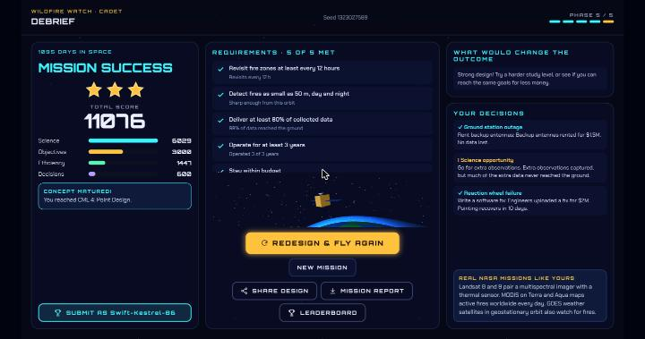

# SATIT Orbital

**Design a real space mission. Launch it. Live with every trade-off.**

A browser game for the 2026 NASA Space Apps Challenge (*Space Mission Design Game*, Games · Beginner/Youth → Intermediate). Players pick a mission, build a spacecraft, choose an orbit and rocket, pick ground stations, fly the mission through emergencies in a real-time 3D view, and get a debrief that explains *why* it succeeded or failed. Play solo with an AI crew, with 2–4 players on one device, or online with up to 4 crew on separate devices.

### ▶ [Play SATIT Orbital now](https://satit-orbital.deweysworld.app)

**Live game:** https://satit-orbital.deweysworld.app (also at https://satit-orbital.deweytng.workers.dev) · **30-second demo:** https://youtu.be/FrKmwO81C5I

[](https://youtu.be/FrKmwO81C5I)

By **Team SATIT Orbital**. Sources, credits and SI-use disclosure are [at the end of this page](#sources-and-credits).

## How it plays

| Phase | NASA mission segment | What you do |
|---|---|---|
| 1 · Objective | User segment | Pick one of 5 missions (CubeSat Classroom, Wildfire Watch, Lunar Relay, Asteroid Scout, Red Planet Weather), a mode and a study level. |
| 2 · Hangar | Space segment | Choose a structure, solar array, battery, radio, computer, pointing system, engine and instruments. Your spacecraft is built in 3D as you go, and live gauges show mass, power, budget, data and Δv. |
| 3 · Launch & orbit | Launch segment | Pick an orbit (LEO, geostationary, halo, interplanetary…) shown in 3D, and a rocket that can lift your mass there. Then watch the launch. |
| 4 · Operate | Ground segment | Pick ground stations, then fly the mission in 3D. Emergencies (solar storms, debris, budget cuts) need crew decisions. |
| 5 · Debrief | — | Requirements met, score breakdown, what would change the outcome, real NASA missions like yours, verified leaderboard. |

| Hangar | Launch & orbit |
|---|---|
|  |  |
| **Emergency vote** | **Debrief** |
|  |  |

Every choice has consequences: more instruments mean more mass, power, cost and data; a weak radio wastes science; far from Earth you need bigger dishes and the Deep Space Network.

## Features

- **Real-time 3D** (Three.js): procedural planets (Earth with clouds and atmosphere, Moon, Mars, an asteroid), orbit paths shaped like each real orbit type, a spacecraft model built from your parts, live downlink beams and emergency alarms. Drag to look around, scroll to zoom. Falls back to 2D art without WebGL.
- **Game feel:** animated page transitions, launch countdown with camera shake and warp, synthesized sound effects and mission-control ambience (no audio files), crew dialogue, star ratings.
- **Five modes:** solo with an AI crew, local co-op (2–4 players), online co-op (up to 4, Durable Objects), versus with a shared challenge code, and sandbox.
- **Learning built in:** every warning explains *why*, every emergency ends with a "why it matters" lesson, and the debrief suggests what would have changed the result.
- **Accessible:** keyboard playable, screen-reader labels, honours "reduce motion", sound can be muted.
- **Automatic leaderboard:** when a ranked mission ends, the score is sent by itself (generated callsign only). The server replays the whole mission to verify it.
- **Daily Challenge:** one shared mission and seed every day (UTC), with its own leaderboard.
- **Watch top runs:** replay any saved run on the operations screen. Replays of a still-open daily board or a fresh challenge unlock later, so nobody can copy a leader's run.
- **Classroom mode:** a teacher makes a class code (no names, no accounts), students join and their scores count for the class, with a class table and a printable report.
- **Spectator mode:** friends can watch an online co-op mission live, read-only.
- **Guided first mission:** a step-by-step coach that follows the real game flow (on for first-time players, with Skip and Hide).
- **Thai language:** an EN / ไทย switch for the interface, mission text and crew advice (machine-assisted translation, please report mistakes).
- **Result card:** save or share a PNG of your result.
- **Realistic revisit times:** how often a low-Earth-orbit satellite sees the same place is worked out from its altitude and the camera's swath width (a Landsat-like camera takes about 15 days, a MODIS-like one about 1 day), so choosing a camera is a real trade-off.

## Run locally

Requires Node.js 20+.

```bash
npm install
npm run db:migrate:local   # create the local D1 leaderboard table
npm run dev                # http://127.0.0.1:8787
```

The game also works with no backend at all (any static file server pointed at `public/`): leaderboard and online rooms switch off automatically.

## Tests

```bash
npm test             # engine unit tests (node:test)
npm run check        # bundle the Worker without deploying
npm run test:smoke   # API, seeds, daily, replays, classes and room/spectator tests, against a running `npm run dev`
npm run verify       # compare this checkout with the judged version (provenance.json)
```

GitHub Actions runs all three on every push and pull request (`.github/workflows/ci.yml`).

## Deploy to Cloudflare

The live version runs at https://satit-orbital.deweysworld.app (and https://satit-orbital.deweytng.workers.dev). To deploy your own copy from your machine:

```bash
npx wrangler login
npx wrangler d1 create satit-orbital        # copy the database_id into wrangler.jsonc
npm run db:migrate:remote
npm run deploy
```

Or from GitHub: add the repository secrets `CLOUDFLARE_API_TOKEN` and `CLOUDFLARE_ACCOUNT_ID`, put the real `database_id` in `wrangler.jsonc`, then run the **Deploy to Cloudflare** workflow from the Actions tab.

Uses Workers Free plan features: static assets, D1, and SQLite-backed Durable Objects.

## Architecture

```
public/                 static game (no build step)
  index.html
  css/game.css
  js/data.js            missions, parts, orbits, rockets, ground stations, events
  js/engine.js          pure, deterministic rules + simulation (shared with the server)
  js/views.js           HTML templates for each screen
  js/main.js            state, rendering, transitions, simulation loop, online sync
  js/scene3d.js         Three.js 3D views
  js/net.js             leaderboard + room client
  js/replay.js          watch saved runs
  js/classroom.js       classroom overlay and print report
  js/card.js            result card (PNG)
  js/tutorial.js        guided first mission
  js/i18n.js, th.js     Thai language
  js/provenance.js      "Originally by" badge and copy notice
  js/fx.js              synthesized sound effects
  vendor/               three.module.min.js (Three.js r170, MIT)
src/worker.js           Cloudflare Worker API + MissionRoom Durable Object
migrations/             D1 schema
scripts/provenance.mjs  fingerprints of the judged version (see below)
provenance.json         SHA-256 of every shipped file in the judged version
test/                   unit and smoke tests
docs/screenshots/       images for this README
```

- **Verified scores.** The client submits its design, random seed and emergency decisions. The Worker replays the mission with the same `engine.js` and stores the server-computed score in D1. Designs that could never launch are rejected, and Versus challenge runs use a seed derived on the server so every team faces the same emergencies. Known limit: on the open boards the player's browser picks the seed, so a determined player could try many seeds offline.
- **Online rooms.** One Durable Object per 5-character room code holds the Commander's mission state and relays crew messages over WebSockets (hibernation API). The Commander's browser runs the simulation and streams snapshots; other crew vote on emergencies and own different parts of the spacecraft. Seats can be reclaimed after a dropped connection, and idle rooms clean themselves up after 24 hours.
- **No personal data.** Leaderboard names are generated callsigns (e.g. `Swift-Falcon-07`); free text is rejected. Classes are random codes only.
- **Server-issued seeds.** Ranked open runs ask the server for a one-time random seed, which is spent in the same transaction as the score, so players cannot shop for an easy run. Known limit: the seed limiter is global, so a determined spammer could make ranked play fall back to "offline run" for everyone for a while.

## The version submitted to NASA Space Apps

SATIT Orbital was submitted to the 2026 NASA Space Apps Challenge on **November 14, 2026 at 10:46 PM (UTC+7)**. That exact version is preserved:

```bash
git checkout v1.0-submitted     # the tag, or: git checkout submitted
```

`provenance.json` lists a SHA-256 fingerprint for each shipped file in that version. In any copy of this project, run `npm run verify` to see how many files are identical to the submitted version (for example "16 of 17 files, 94%"). The game also shows a small "Originally by SATIT Orbital: github.com/deweyyyyy/satit-orbital" line, and a notice when it is served from a website other than the official ones. This is an open-source project (MIT), so copying is allowed; these are here so the origin stays clear.

## Sources and credits

NASA does not endorse this project. It is an independent entry to the 2026 NASA Space Apps Challenge.

### NASA data and resources used

| Resource (from the challenge's Resources tab) | How the game uses it |
|---|---|
| Design and Develop Science Missions | The four mission segments (user, space, launch, ground) become the game's phases. |
| Concept Maturity Levels (CMLs), JPL | Player rank: CML 1 Cocktail Napkin → CML 4 Point Design. |
| Mission Design Lab (MDL) | Difficulty levels (Office Hours, Trade Study, Point Design) and the spacecraft subsystem categories. |
| General Mission Analysis Tool (GMAT) | The families of orbits offered in Phase 3 (LEO, geostationary, lunar, libration-point/halo, interplanetary). |
| A Learning Game About Telescopes | Objectives drive engineering choices; levels of complexity; launch animation; "real NASA missions like yours". |
| CubeSat 101 | The CubeSat Classroom mission: form factors, mass limits, CubeSat Launch Initiative vs. rideshare. |
| NASA Mission Viz | Inspiration for the 3D orbit views. |
| Visualize a Space Mission Using Virtual Reality (Space Apps 2023) | Mission concept → trajectory → timeline structure. |
| CSA Digital Games and Activities (partner resource) | General design reference; no content reused. |

CubeSat size and mass limits follow the [CubeSat Design Specification Rev. 14.1](https://www.nasa.gov/wp-content/uploads/2018/01/cubesatdesignspecificationrev14_12022-02-09.pdf) (Cal Poly, hosted by NASA): 1U up to 2 kg, 3U up to 6 kg, 6U up to 12 kg.

Real missions mentioned in the game as references: Landsat 8 and 9, MODIS (Terra and Aqua), GOES, CubeSat Launch Initiative, CAPSTONE, NEAR Shoemaker, OSIRIS-REx, Mars Reconnaissance Orbiter (MARCI), Kepler/K2, the International Space Station and the Deep Space Network.

**Simplified for play:** part masses, power, costs, data rates, budgets, rocket capacities, signal multipliers, revisit times, scores and emergency odds are game-balance values, not NASA data. Mission budgets are scaled down for play (real Mars orbiters cost far more). The relationships between them are meant to be realistic.

### Software and assets

| Item | License |
|---|---|
| This game's code | MIT ([LICENSE](LICENSE)) |
| [Three.js](https://threejs.org/) r170 (`public/vendor/`) | MIT |
| Wrangler (development and deployment) | MIT OR Apache-2.0 |
| Orbitron and Chakra Petch fonts (Google Fonts) | SIL Open Font License |
| Icons, 3D models, textures and sound effects | Generated by our code at runtime (MIT) |
| Hosting: Cloudflare Workers, D1, Durable Objects | Used under Cloudflare's terms; no Cloudflare code redistributed |

### Use of Super Intelligence (SI) tools

SATIT Orbital was made with assistance from **Claude (Anthropic)**, a large language model (an SI tool), for: ideation (the game concept and mechanics), research (rules and NASA resource summaries), game-balance analysis, the code (HTML, CSS, JavaScript, Three.js scenes, Web Audio sounds, Cloudflare Worker), the UI and visual design, scenario text and crew dialogue, tests, CI and this README. The game does not use SI at runtime: the "AI crew" follows fixed rules. Each source file says so in its header comment, and `index.html` has an `si-assistance` meta tag. No SI-generated image, video or audio files are used. All graphics and sounds are produced at runtime by SI-assisted code, so the title screen carries a visible "SI-assisted" notice, and the screenshots above are captures of the running game.

## License

[MIT](LICENSE).
